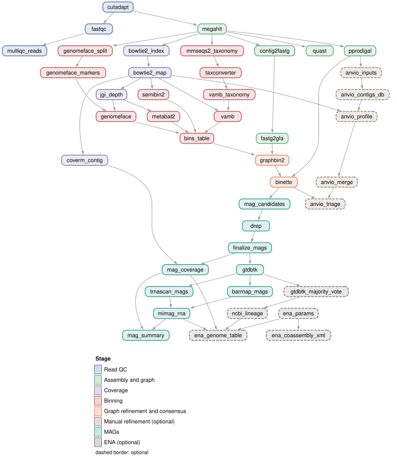

# bass-fastq-to-mag

[](https://github.com/sprdmt/bass-fastq-to-mag/actions/workflows/ci.yml)
[](https://snakemake.github.io)
[](LICENSE)

A containerized Snakemake workflow that turns paired-end metagenomic reads into dereplicated,
classified metagenome-assembled genomes (MAGs) ready for submission to the European Nucleotide
Archive. It combines four complementary binners, refines every binning with the assembly graph
and builds consensus bins. It was developed at the University of Vienna for metagenomes of the
sea-surface microlayer and runs on any SLURM cluster or single machine with Apptainer or conda.



*Every step of a full run, coloured by stage. Dashed boxes are optional: manual refinement in anvi'o
and ENA submission.*

## What it does

| step | tools |
|---|---|
| read QC | cutadapt (adapter and quality trimming), FastQC, MultiQC |
| co-assembly | MEGAHIT per assembly group; QUAST |
| assembly graph | MEGAHIT contig2fastg with the final k detected from the contigs, agtools (FASTG to GFA) |
| genes | Prodigal (meta mode, parallelized with pprodigal) |
| coverage | Bowtie2 + SAMtools, CoverM, MetaBAT2 depth table |
| binning | MetaBAT2, GenomeFace (GPU), SemiBin2 (GPU or CPU), TaxVAMB with MMseqs2 taxonomy (GPU or CPU) |
| graph refinement | GraphBin2 (corrected fast implementation, see [docs/graphbin2.md](docs/graphbin2.md)) for every binner |
| consensus | Binette with CheckM2 |
| manual refinement (optional) | anvi'o workspace with automatic triage of the bins worth refining |
| dereplication | dRep across all assembly groups |
| annotation | GTDB-Tk (GTDB R226), barrnap and tRNAscan-SE for MIMAG rRNA/tRNA criteria, CoverM coverage |
| submission (optional) | ENA co-assembly and MAG submission with genome_uploader and Webin-CLI (test server by default) |

Highlights:

* **Several co-assemblies in one run.** Samples are grouped by the `assembly_group` column of
  the sample sheet. Each group is assembled and binned separately, and the bins of all groups are
  dereplicated together.
* **Graph-aware bins.** GraphBin2 propagates bin labels along the assembly graph. The workflow
  ships a corrected implementation that gives the same result as upstream GraphBin2 with two
  bugs fixed, in under 30 s instead of about 4 h per binner on a 428,000-contig co-assembly. It
  also refuses to continue on a graph without edges, a silent failure mode of MEGAHIT-based
  pipelines (see [docs/graphbin2.md](docs/graphbin2.md)).
* **Size-aware resources.** Threads, memory and run time of every job are estimated from the
  size and number of its inputs and capped by limits you set for your cluster. Failed jobs are
  retried with more memory ([docs/resources.md](docs/resources.md)).
* **Manual refinement only where it pays off.** The optional anvi'o step sorts the consensus
  bins into keep / refine / drop and writes a list of the bins to refine, each with its
  `anvi-refine` command ([docs/manual_refinement.md](docs/manual_refinement.md)).
* **Reproducible software.** Every rule runs in a pinned container (BioContainers, or images of
  this repository for the GPU binners) or a pinned conda environment.

## Quick start

```bash
# 1. Snakemake (>= 8.20) and, for clusters, the SLURM executor plugin
conda create -n snakemake -c conda-forge -c bioconda snakemake snakemake-executor-plugin-slurm
conda activate snakemake

# 2. The workflow
git clone https://github.com/sprdmt/bass-fastq-to-mag.git
cd bass-fastq-to-mag

# 3. Describe your samples and settings
#    config/samples.tsv  - sample, fq1, fq2, assembly_group (+ ENA accessions for submission)
#    config/config.yaml  - project name, database paths, binners, thresholds
#    (see config/README.md)

# 4. Reference databases: point config/config.yaml to existing copies, or download them
snakemake download_databases --workflow-profile profiles/local

# 5. Check the plan, then run
snakemake -n --workflow-profile profiles/slurm
snakemake --workflow-profile profiles/slurm
```

`profiles/slurm` submits every job to SLURM and runs it in its Apptainer image. Adapt the account,
partitions and GPU request in that file, or copy `profiles/lisc` as an example of a configured
cluster. `profiles/local` runs everything on one machine. To use conda environments instead of
containers, add `--software-deployment-method conda`.

### Interrupted or stuck runs

* Run Snakemake itself in `tmux`/`screen` on a login node, or as a small long SLURM job
  (4 CPUs, 16 GB). After an interruption, run `snakemake --unlock` with the same options and then
  the original command again: finished jobs are kept and incomplete ones are redone.
* When the Snakemake process is killed (for example by `scancel` of its head job), jobs it had
  already submitted can keep running. All jobs of one run carry the run ID printed at the start
  of the Snakemake log as their SLURM job name, so check `squeue -u $USER` and use
  `scancel --name <run ID>`.
* A job you cancel by hand (`scancel <job ID>`) is not recognised as failed by
  snakemake-executor-plugin-slurm 2.6.1, and Snakemake keeps waiting for it. Stop Snakemake and
  start it again; the job is then resubmitted.

### Targets

| target | result |
|---|---|
| `all` (default) | everything up to `results/mags/mag_summary.tsv` |
| `qc` | trimmed reads and the MultiQC report |
| `assembly` | co-assemblies, assembly graphs, QUAST |
| `bins` | binner, GraphBin2 and Binette bins |
| `anvio` | anvi'o workspace with the triaged collections for manual refinement |
| `mags` | dereplicated, named and classified MAGs |
| `ena_prepare`, `ena_validate`, `ena_submit` | ENA submission files, validation, submission (see [docs/ena_submission.md](docs/ena_submission.md)) |
| `download_databases` | CheckM2, GTDB-Tk, MMseqs2 and anvi'o reference data |

## Outputs

The main result is `results/mags/mag_summary.tsv`: one row per MAG with completeness,
contamination, quality class (MIMAG high-quality, near-complete, medium-quality), GTDB taxonomy,
genome statistics, coverage per sample and dRep cluster. The MAGs are in
`results/mags/fasta/<project>_MAG_<n>.fna`. All outputs are described in
[docs/outputs.md](docs/outputs.md).

## Documentation

* [config/README.md](config/README.md): sample sheet and settings
* [docs/databases.md](docs/databases.md): reference databases
* [docs/resources.md](docs/resources.md): resource model, cluster limits, calibration
* [docs/graphbin2.md](docs/graphbin2.md): assembly graph and GraphBin2 implementation
* [docs/manual_refinement.md](docs/manual_refinement.md): anvi'o triage and refinement
* [docs/ena_submission.md](docs/ena_submission.md): ENA submission
* [docs/outputs.md](docs/outputs.md): output files
* [containers/README.md](containers/README.md): container images and how they are built

## Testing

`.test/` holds a small configuration that is used by the continuous integration
(`.github/workflows/ci.yml`): formatting (snakefmt), `snakemake --lint`, dry runs of all targets
and configuration variants, and unit tests (`pytest tests/`) of the helper scripts, the ENA
scripts and GraphBin2. The GraphBin2 tests compare `graphbin2_fast.py` with upstream GraphBin2
1.3.3 carrying only the two bug fixes, on targeted cases, random graphs and a medea-II subgraph
([docs/graphbin2.md](docs/graphbin2.md)).

After adding or removing rules, regenerate the rule graph at the top of this page with
`python docs/images/make_rulegraph.py` (from the repository root; needs graphviz). The script
stops with a list of any rules that are not yet assigned to a stage.

## Citation

If you use this workflow, please cite it (see [CITATION.cff](CITATION.cff)) together with the
tools it runs:

* Snakemake: Mölder F. et al. (2021) Sustainable data analysis with Snakemake. *F1000Research* 10:33.
* cutadapt: Martin M. (2011) Cutadapt removes adapter sequences from high-throughput sequencing reads. *EMBnet.journal* 17:10-12.
* FastQC: Andrews S. (2010) FastQC: a quality control tool for high throughput sequence data. Babraham Bioinformatics.
* MultiQC: Ewels P. et al. (2016) *Bioinformatics* 32:3047-3048.
* MEGAHIT: Li D. et al. (2015) *Bioinformatics* 31:1674-1676.
* QUAST: Gurevich A. et al. (2013) *Bioinformatics* 29:1072-1075.
* agtools: Mallawaarachchi V. et al. (2026) *Bioinformatics Advances* 6:vbag126, doi:10.1093/bioadv/vbag126.
* Prodigal: Hyatt D. et al. (2010) *BMC Bioinformatics* 11:119; pprodigal: https://github.com/sjaenick/pprodigal
* Bowtie2: Langmead B., Salzberg S.L. (2012) *Nature Methods* 9:357-359.
* SAMtools: Danecek P. et al. (2021) *GigaScience* 10:giab008.
* CoverM: Aroney S.T.N. et al. (2025) *Bioinformatics* 41:btaf147.
* SeqKit: Shen W. et al. (2024) *iMeta* 3:e191.
* MetaBAT2: Kang D.D. et al. (2019) *PeerJ* 7:e7359.
* GenomeFace: Lettich R. et al. (2024) *bioRxiv* 2024.02.07.579326.
* SemiBin2: Pan S. et al. (2023) *Bioinformatics* 39:i21-i29.
* VAMB: Nissen J.N. et al. (2021) *Nature Biotechnology* 39:555-560; TaxVAMB: Kutuzova S. et al. (2024) *bioRxiv* 2024.10.25.620172; taxconverter: https://github.com/RasmussenLab/taxconverter
* MMseqs2: Steinegger M., Söding J. (2017) *Nature Biotechnology* 35:1026-1028; taxonomy: Mirdita M. et al. (2021) *Bioinformatics* 37:3029-3031; GPU: Kallenborn F. et al. (2025) *Nature Methods* 22:2024-2027.
* GraphBin2: Mallawaarachchi V.G., Wickramarachchi A.S., Lin Y. (2021) *Algorithms for Molecular Biology* 16:3.
* Binette: Mainguy J., Hoede C. (2024) *Journal of Open Source Software* 9:6782.
* CheckM2: Chklovski A. et al. (2023) *Nature Methods* 20:1203-1212.
* dRep: Olm M.R. et al. (2017) *ISME Journal* 11:2864-2868.
* GTDB-Tk: Chaumeil P.-A. et al. (2022) *Bioinformatics* 38:5315-5316; GTDB: Parks D.H. et al. (2022) *Nucleic Acids Research* 50:D785-D794.
* barrnap: https://github.com/tseemann/barrnap
* tRNAscan-SE: Chan P.P. et al. (2021) *Nucleic Acids Research* 49:9077-9096.
* anvi'o: Eren A.M. et al. (2021) *Nature Microbiology* 6:3-6.
* MIMAG: Bowers R.M. et al. (2017) *Nature Biotechnology* 35:725-731; near-complete genomes: Almeida A. et al. (2019) *Nature* 568:499-504.
* ENA submission: genome_uploader (https://github.com/EBI-Metagenomics/genome_uploader) and Webin-CLI (https://github.com/enasequence/webin-cli).
* Containers: BioContainers (da Veiga Leprevost F. et al. (2017) *Bioinformatics* 33:2580-2582), Bioconda (Grüning B. et al. (2018) *Nature Methods* 15:475-476), Apptainer.

## License

MIT, see [LICENSE](LICENSE).
